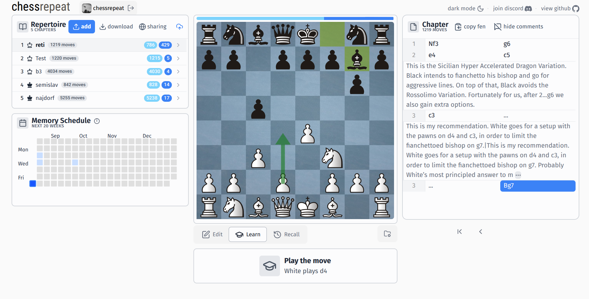

# chesspractice

chesspractice is a personal chess opening trainer: build a repertoire, then drill it with spaced repetition.

It features move scheduling with spaced repetition, a playground mode to train without logging in, real-time
collaborative training, and an interface to edit your repertoire and track training progress.

## Stack

| Layer | Tech | Hosting (free tier) |
|---|---|---|
| Frontend | [React](https://react.dev/) + [TypeScript](https://www.typescriptlang.org/) + Vite, [chessground](https://github.com/lichess-org/chessground), [chessops](https://github.com/niklasf/chessops) | [Vercel](https://vercel.com/) |
| Backend | [Go](https://go.dev/) HTTP API + [WebSockets](https://developer.mozilla.org/en-US/docs/Web/API/WebSockets_API) | [Render](https://render.com/) |
| Database | [PostgreSQL](https://www.postgresql.org/) | [Neon](https://neon.tech/) |
| Auth | [Firebase Auth](https://firebase.google.com/docs/auth) (Google, email + password); the backend verifies Firebase ID tokens and issues its own session cookie | Firebase (Spark) |

Deployment and local setup: see [DEPLOY.md](DEPLOY.md).

---

### Spaced Repetition in chesspractice

chesspractice schedules your reviews with [**spaced repetition**](https://en.wikipedia.org/wiki/Spaced_repetition),
which rewards correct guesses with reviews that are scheduled at increasingly longer intervals (in 1 day, 3 days, a week, etc...). The goal here is to minimize the amount of time you spend reviewing moves that you already know.

More specifically, chesspractice uses the [**FSRS**](https://github.com/open-spaced-repetition/ts-fsrs) algorithm to
schedule moves. We store a *stability* and *difficulty* number in each move and use them to approximate when a move
should be next trained.

Read more about FSRS [here](https://github.com/open-spaced-repetition/fsrs4anki/wiki).
